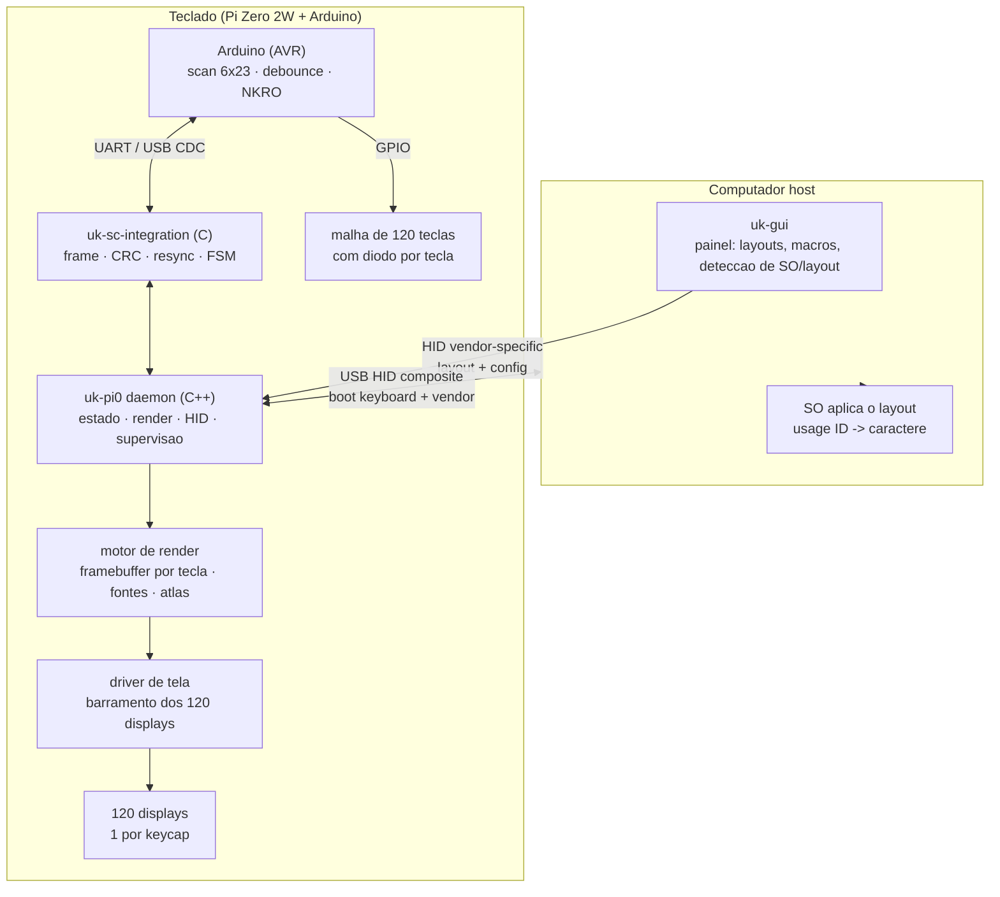

# Context Map — UniversalKeyboard

> Ponto de entrada obrigatório. Leia antes de tocar em código.
> Estado: **Fase 0 — definição de arquitetura**. Decisões marcadas `[A VALIDAR]` não estão
> congeladas e bloqueiam a implementação do módulo que dependem.

---

## 1. O que é o UniversalKeyboard

Um **teclado físico full-size de 120 teclas em que cada keycap é uma tela**. O teclado se
apresenta ao computador host como um teclado USB HID padrão — nada é necessário instalar
para digitar — mas o que aparece em cada tecla é dinâmico:

- O layout exibido se **adapta ao computador conectado**: se o host espera ABNT2, as
  legendas mostram ABNT2; se espera ANSI US, mostram ANSI US.
- As teclas podem ser reconfiguradas: macros, atalhos, ícones, camadas.
- Um painel multiplataforma (`uk-gui`) edita layouts, macros e o que é exibido.

Referência conceitual: o que o **VIA** faz pelo QMK — mas aqui o alvo do editor é um
teclado com tela por tecla, e o layout também responde ao sistema operacional do host.

### O problema técnico central

Um teclado USB HID **não envia caracteres**. Ele envia *usage IDs* (ex.: `0x14` = tecla
física do `a` no padrão US). Quem traduz usage → caractere é o **layout ativo no SO do
host**. Consequência dura:

> Se o host está em ABNT2, `0x2F` produz `ç`; se está em US, produz `[`.
> A legenda na tela da tecla precisa refletir essa tradução.

Portanto a legenda correta depende de uma informação que **não existe no protocolo HID**:
qual layout o host está usando. Ver §7.

---

## 2. Partes do projeto

| Repo | Papel | Linguagens | Onde executa |
|---|---|---|---|
| **`uk-gui`** | Painel multiplataforma: gerencia o driver, define o que aparece nas telas, edita macros e layouts. **Detecta o layout ativo do host** (por SO e por fingerprint) e o envia ao teclado. | A definir — candidatos: Rust, C++, C + toolkit nativo | Host (Windows / Linux / macOS) |
| **`uk-pi0`** | Daemon do controlador. Recebe eventos da malha, mantém estado, renderiza as teclas, aciona o driver de tela, expõe o teclado USB ao host. | C++17 (núcleo C17) | Raspberry Pi Zero 2W |
| **`uk-sc-integration`** | Contrato e implementação do link entre o Pi e o Arduino da malha: protocolo, framing, CRC, máquinas de estado, **e o firmware do Arduino**. | C (núcleo portável + AVR) | Pi Zero 2W e ATmega |
| *(hardware)* | Malha de 120 teclas, 120 displays, 2 placas (matriz + controle) | — | bancada |

Além dos três repos de produto, a raiz `UniversalKeyboard/` é um **repo guarda-chuva**: versiona
`docs/` e `.github/` e registra cada subrepo como submódulo git (`.gitmodules` com URLs
relativas).
Não contém código de produto e não é monorepo.

### Fronteiras invioláveis

- `uk-gui` **não** linka biblioteca de `uk-pi0` nem de `uk-sc-integration`. Fala com o
  teclado **somente** pelo protocolo HID vendor-specific (§6.2). É um cliente externo.
- `uk-sc-integration` é o **dono exclusivo** do layout de frame do link serial. Mudança de
  frame exige ADR + bump de versão de protocolo.
- `uk-pi0` consome o contrato; nunca redefine o frame localmente.
- Nenhum repo inclui header privado de outro. Só headers públicos de contrato.

---

## 3. Arquitetura



### Caminho de um acionamento

1. Arduino varre a malha continuamente (coluna a coluna), aplica debounce e detecta transição.
2. Emite evento no frame serial com CRC.
3. `uk-sc-integration` faz de-framing, valida CRC, atualiza a FSM do link e entrega o
   evento tipado ao daemon.
4. `uk-pi0` resolve o usage ID considerando **layout ativo + camada + macro**.
5. Envia o relatório HID ao host e, se a tecla mudou de aparência (ex.: Shift pressionado
   troca a legenda), marca a tecla como *suja*.
6. O renderizador recompõe apenas as teclas sujas e escreve no driver de tela.

### Caminho de troca de layout

1. `uk-gui` detecta SO + layout ativo do host (§7) — no arranque e em cada mudança.
2. Envia ao teclado pelo canal vendor-specific: `layout_id`, variante, tabela de legendas.
3. `uk-pi0` valida, persiste por fingerprint de host, e marca **todas** as 120 teclas como
   sujas.
4. O renderizador faz uma atualização de tela cheia em background, priorizando a linha da
   tecla que o usuário acabou de acionar.

---

## 4. Restrição numérica que define o projeto

Um display de 128×128 em RGB565 ocupa **32.768 bytes**. Multiplicado por 120 teclas:

| Operação | Dados | Tempo a 40 MHz SPI (~5 MB/s) |
|---|---|---|
| Atualizar **1** tecla | 32 KB | ~6,5 ms |
| Atualizar **10** teclas | 320 KB | ~65 ms |
| **Tela cheia** (120 teclas) | 3,93 MB | **~786 ms** |

Conclusões que o código deve respeitar:

- **Nunca** redesenhar a tela inteira em resposta a um evento de tecla.
- Toda atualização é **incremental e por tecla suja** (dirty-key), com fila e *coalescing*.
- Troca de layout é aceitável a ~786 ms, **desde que em background** e sem bloquear o
  caminho de digitação.
- Animação só é viável em poucas teclas simultâneas. O orçamento é explícito, não implícito.
- Se o barramento real entregar menos que 5 MB/s, o orçamento muda: **medir antes de assumir**.

---

## 5. Stack e toolchain

### Raspberry Pi Zero 2W (ARM Cortex-A53)

- SO: Raspberry Pi OS Bookworm ou superior. `[A VALIDAR]` 32-bit vs 64-bit.
- Build nativo: `gcc`/`g++` (C17 / C++17).
- Cross: `aarch64-linux-gnu-gcc` (64-bit) ou `arm-linux-gnueabihf-gcc` (32-bit).
- Assembly: AArch64 ou AArch32/Thumb-2, conforme o SO escolhido.
- Serviço: `systemd` (`Type=notify`, `Restart=always`, `WatchdogSec=`).
- USB: gadget via `configfs`/`libcomposite` com `dwc2` em modo peripheral. `[A VALIDAR]`
- Render: CPU (sem GPU) — composição em software, otimizada; NEON é o teto de aceleração.

### Arduino / AVR

- Alvo: ATmega328P (Uno/Nano) ou ATmega32U4 (Micro). `[A VALIDAR]`
- 120 teclas ⇒ matriz **6 linhas × 23 colunas**, com **um diodo por tecla** (anti-ghosting).
- Compilador: `avr-gcc` (C11, `-Os`). Build via `arduino-cli` ou `Makefile`.
- RAM: 2 KB no 328P — orçamento apertado, sem `String`, sem alocação dinâmica.

### `uk-gui` (host)

Stack **não decidida**. Requisitos declarados, que restringem a escolha:

- Próximo do kernel, baixo custo computacional, extrema performance.
- Multiplataforma: Windows, Linux, macOS.
- Precisa **ler o layout de teclado ativo do SO** em cada plataforma (§7).
- Precisa falar HID vendor-specific com o teclado (acesso a dispositivo HID bruto).

Candidatos a avaliar em ADR: Rust (acesso direto a Win32/X11/CoreFoundation + crate HID,
UI leve), C++ (Qt ou toolkit nativo), C + toolkit nativo.

> Não presuma a stack nos arquivos de configuração. O agente deve perguntar antes de criar
> código em `uk-gui` e registrar a escolha em ADR.

---

## 6. Contratos

### 6.1 Arduino ↔ `uk-sc-integration` (link serial)

Proposta inicial — **`[A VALIDAR]`**, formalizar em ADR-0002.

```text
+------+------+------+--------+---------+-------+
| SOF  | VER  | TYPE | LEN(1) | PAYLOAD | CRC16 |
| 0xA5 | 0x01 | 0xT  |   N    |   N B   |  2 B  |
+------+------+------+--------+---------+-------+
```

- `LEN` máx. 64 B. `CRC16` = CCITT-FALSE sobre `VER..PAYLOAD`.
- Byte-stuffing ou COBS quando o payload contiver `0xA5` (decidir em ADR).
- CRC inválido ⇒ descarta o frame, continua o de-framing, incrementa contador de erro.
- Heartbeat ausente por > 250 ms ⇒ daemon entra em `SAFE` e **libera todas as teclas**.

### 6.2 `uk-gui` ↔ `uk-pi0` (HID vendor-specific)

Canal de controle, separado da interface de teclado. `[A VALIDAR]` — definir em ADR-0003.

- Interface HID **vendor-defined**, no mesmo dispositivo USB composto do teclado.
- Operações: `GET_INFO`, `SET_HOST_LAYOUT`, `SET_KEY_IMAGE`, `SET_MACRO`, `SET_PROFILE`,
  `COMMIT` (aplica em lote, atômico), `GET_STATS`.
- Toda mensagem tem `version`, `opcode`, `len`, `payload`, `crc`.
- Escrita é transacional: nada é aplicado ao hardware antes de `COMMIT`.
- Limite de payload por report é pequeno (HID): transferências grandes são fatiadas com
  `offset` + `seq`, e a montagem é validada antes do `COMMIT`.

### 6.3 `uk-pi0` ↔ host (USB HID)

- Interface 0: teclado **boot protocol** (para BIOS/UEFI e KVM funcionarem).
- Interface 1: **report protocol** com bitmap NKRO de 120 bits — usado quando o host
  suporta.
- Interface 2: **vendor-specific** (§6.2).
- Regra dura: nunca enviar modificador sem keycode correspondente; sempre enviar
  relatório de todas-as-teclas-liberadas na transição para `SAFE`/shutdown.

---

## 7. Detecção de layout do host

Decisão: **a detecção acontece em `uk-gui`**, que envia o resultado ao teclado.
Confirmado pelo autor do projeto.

### Por sistema operacional

| SO | API / fonte | Observações |
|---|---|---|
| Windows | `GetForegroundWindow` + `GetWindowThreadProcessId` + `GetKeyboardLayout` | Layout é *por thread/janela*: precisa reavaliar no foco. ABNT2 = `0x0416`, US = `0x0409`. Notificação: `WM_INPUTLANGCHANGE`. |
| Linux X11 | `XkbGetState` / `xkbcommon` | Funciona por janela. |
| Linux Wayland | `gsettings get org.gnome.desktop.input-sources` (GNOME), API do compositor | **Não há API universal.** Wayland não expõe layout global por design. |
| macOS | `TISGetInputSourceProperty` (`kTISPropertyInputSourceID`) | Notificação: `kTISNotifySelectedKeyboardInputSourceChanged`. |

### Fingerprint do SO

Usada para associar um perfil salvo ao computador, sem depender de hostname:

- Windows: `MachineGuid` (HKLM) + versão do SO.
- Linux: `/etc/machine-id` + `ID`/`VERSION_ID` de `/etc/os-release`.
- macOS: `IOPlatformUUID`.

Regra: o perfil é salvo por fingerprint; sem correspondência, cai em layout padrão
configurado e o usuário pode fixar manualmente.

### Limite honesto

Fingerprint identifica a **máquina**, não o layout. Layout muda por janela (Windows, X11) e
por configuração do usuário. Portanto:

- Reavaliar layout em evento de troca, não só no arranque.
- Se `uk-gui` não estiver rodando, o teclado **mantém o último layout persistido** e
  sinaliza na tela de status que está em modo "layout fixo".

---

## 8. Invariantes não negociáveis

1. **Fail-safe de teclas.** Perda de link, timeout, exceção, `SIGTERM`/`SIGINT` ou watchdog
   ⇒ liberar todas as teclas e modificadores, entrar em `SAFE`.
2. **Digitar nunca depende da tela.** Falha no driver de tela ou no renderizador não pode
   impedir o teclado de funcionar. Render é degradação graciosa.
3. **Digitar nunca depende de `uk-gui`.** Sem o painel, o teclado opera com o último
   perfil persistido.
4. **Boot protocol sempre funcional.** O teclado precisa funcionar em BIOS/UEFI, KVM e
   instalador de SO.
5. Sem alocação dinâmica após init no MCU.
6. ISR curta e determinística: sem log, sem bloqueio, sem `malloc`, sem espera.
7. Dado compartilhado com ISR exige `volatile` + seção crítica (ou atômico).
8. Sem `delay()`/`sleep()` no caminho de evento.
9. Toda entrada externa é hostil: frame serial, report HID, arquivo de config e `argv`
   são validados (tamanho, faixa, CRC) antes do uso.
10. Nenhuma credencial, chave ou IP privado versionado.
11. **Nunca redesenhar a tela inteira por evento de tecla** (§4).

---

## 9. Convenções de código

### Idioma

| Artefato | Idioma |
|---|---|
| Identificadores, API pública, log técnico | Inglês |
| Comentários de intenção, ADR, README, commit | Português (pt-BR) |
| Texto na tela do usuário | Localizável; nunca hardcoded no meio da lógica |

### Nomenclatura

| Elemento | Convenção | Exemplo |
|---|---|---|
| Arquivo C/C++ | `snake_case` | `key_render.c`, `hid_gadget.cpp` |
| Tipo (C) | `snake_case_t` | `key_event_t` |
| Tipo (C++) | `PascalCase` | `SerialLink` |
| Função | `snake_case`, verbo primeiro | `matrix_scan_step()` |
| Constante / macro | `SCREAMING_SNAKE` com prefixo | `UK_PROTO_MAX_PAYLOAD` |
| Namespace C++ | `uk::` | `uk::proto::decode_frame` |
| Assembly | `snake_case.s`/`.S` | `delay_cycles.S` |

Prefixos: `uk_` para símbolo exportado, `UK_` para macro pública.

### Layout de repositório

```text
<repo>/
├── README.md
├── CMakeLists.txt  ou  Makefile  ou  platformio.ini
├── .clang-format
├── include/     ← API pública
├── src/         ← implementação
├── tests/       ← testes host
├── tools/       ← scripts de apoio
└── docs/        ← notas do repo + ADRs locais
```

---

## 10. Onde encontrar o quê

| Preciso de… | Vá para |
|---|---|
| Agente do projeto | [`.github/agents/tau.agent.md`](../.github/agents/tau.agent.md) |
| Regras gerais | [`.github/copilot-instructions.md`](../.github/copilot-instructions.md) |
| Regras por linguagem/área | [`.github/instructions/`](../.github/instructions) |
| Procedimentos especializados | [`.github/skills/`](../.github/skills) |
| Decisões arquiteturais | [`docs/adr/`](adr) |
| Esquema elétrico (matriz + link) | [`docs/hardware/matriz-e-link.md`](hardware/matriz-e-link.md) |
| CI de cada repo | `uk-*/.github/workflows/ci.yml` |

### Índice de skills

| Skill | Carregar quando |
|---|---|
| `context-map` | Início de sessão; fronteiras e navegação |
| `embedded-c` | C de MCU e de biblioteca portável |
| `cpp-daemon` | C++ do daemon: RAII, sinais, systemd |
| `assembly` | Assembly AVR / ARM |
| `arduino-firmware` | Sketch, build AVR, upload |
| `input-matrix` | Scan 6×23, debounce, diodos, NKRO |
| `display-pipeline` | Driver de tela, fila, dirty-key, orçamento de banda |
| `key-rendering` | Composição da imagem da tecla, fontes, atlas |
| `layout-adaptation` | Detecção de layout no host, tabelas usage→legenda, ABNT2 vs US |
| `hid-gadget` | USB gadget, boot vs report protocol, vendor interface |
| `serial-link` | Frame, CRC, resync, heartbeat |
| `cross-build` | Toolchain, cross-compile, estático, sanitizers |
| `bench-test` | Validação em hardware real / HIL |
| `code-review` | Antes de commit ou PR |
| `git-workflow` | Branch, commit, versionamento multi-repo |
| `workflow-feature` | Funcionalidade ponta a ponta |
| `workflow-bugfix` | Correção com reprodução obrigatória |
| `workflow-release` | Empacotamento e release |

---

## 11. Fluxo do agente `tau`

```text
Entender → Mapear → Planejar → Implementar → Verificar → Registrar
```

Se faltar dado de hardware — pinagem, modelo do AVR, part number do display, versão do
Raspberry Pi OS, stack do `uk-gui` — **perguntar**, nunca assumir.

---

## 12. Decisões pendentes (bloqueiam implementação)

| # | Decisão | Bloqueia | ADR |
|---|---|---|---|
| 1 | Stack do `uk-gui` | Todo o repo `uk-gui` | [ADR-0001](adr/0001-stack-do-uk-gui.md) |
| 2 | Layout de frame serial v1 + stuffing vs COBS | `serial-link`, firmware, daemon | [ADR-0002](adr/0002-frame-do-link-serial.md) |
| 3 | Protocolo HID vendor-specific (opcodes, fatiamento, transação) | `hid-gadget`, `uk-gui`, daemon | [ADR-0003](adr/0003-protocolo-hid-vendor.md) |
| 4 | Modelo/part number do display e barramento (SPI direto, shift-register, controlador dedicado) | `display-pipeline`, `uk-gui` (preview), driver | — |
| 5 | Barramento do Pi: 32-bit (`armhf`) ou 64-bit (`arm64`) | `cross-build`, systemd unit | — |
| 6 | AVR escolhido: ATmega328P ou ATmega32U4 | `arduino-firmware`, `input-matrix` | — |
| 10 | Revisar ADR-0002: 57600 baud (3V3) vs 921600 (5V) | firmware, daemon | ADR-0002 |
| 7 | Pinagem da malha 6×23 e do barramento de display | `input-matrix`, firmware, bancada | — |
| 8 | Conjunto inicial de layouts suportados (ABNT2, ANSI US, …) | `layout-adaptation`, `key-rendering` | — |
| 9 | Protocolo de update de firmware (DFU / bootloader / via Pi) | `workflow-release` | — |

ADRs 0001–0003 estão **Propostos**: registram a análise e a recomendação, mas a decisão é
humana. Enquanto não forem `Aceito`, a implementação do que eles bloqueiam não começa.

Formato de decisão: ver [`docs/adr/0000-template.md`](adr/0000-template.md).
